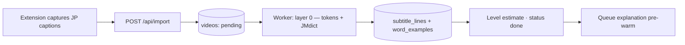

# Architecture

English summary of [`ARQUITETURA.md`](ARQUITETURA.md) (Portuguese), which is the
**canonical version** and wins on any disagreement. This page keeps the
essentials an outside contributor or self-hoster needs: the product, the
open-core model, the locked decisions, and how the system fits together. Where
the code has moved past the original design, an *As built* note says so.

Related: [`CONTRATO_IA.md`](CONTRATO_IA.md) (AI input/output and cache contract,
Portuguese), [`SELF_HOSTING.md`](SELF_HOSTING.md), [`EXTENSION.md`](EXTENSION.md).

## 1. Vision

Fuchine is an open-core platform for learning Japanese by immersion in video.
A user imports a YouTube video, studies it with intelligent dual subtitles
(tokenization, pop-up dictionary, per-line AI explanations), mines sentences in
one click, and reviews them with an SRS whose cards replay the exact clip from
the original video.

The core loop, which everything else serves:

> paste a URL → watch with smart subtitles → mine sentences → review in the SRS → back to the video

Deliberate differentiators:

1. **Open source** with full self-hosting and BYOK (bring your own LLM key).
2. **Structurally cheaper AI**: layered processing (local → cheap → expensive on
   demand) plus a cache shared across users.
3. **Modern SRS (FSRS)** instead of classic SM-2.
4. **Multilingual by design**: Japanese is the first language, not the only one.

Audience: self-taught immersion learners (Refold/AJATT-style communities,
r/LearnJapanese) who already know kana and want listening, grammar in context
and real-world vocabulary.

## 2. Open-core model

**Golden rule:** the open core is the complete product. The paid layer sells
service and convenience, never functionality removed from the code.

| Layer | Contents |
|---|---|
| **Open core (AGPL-3.0)** | Dual-subtitle player, pop-up dictionary (JMdict), local tokenization, one-click mining, clip-based SRS (FSRS), albums, stats, browser extension, BYOK. A self-hoster has all of it and pays their own LLM bill. |
| **Paid cloud (future)** | Managed AI (no key, no setup), a shared cache of already-processed videos, Whisper for videos without captions, managed backups and sync. Each item is a service with a real cost or a network effect, never a locked feature. |

The shared cache is the cloud's structural moat: each processed video becomes
instant and free for the next user, while a self-hosted instance starts with an
empty cache.

- **License:** AGPL-3.0 for the whole repository.
- **Contributions:** DCO (`Signed-off-by`), not a CLA.
- Cloud-only code lives behind `DEPLOYMENT_MODE=cloud` and does not exist yet.

## 3. Locked decisions (D1–D8)

Expensive to reverse. Changing one requires updating `ARQUITETURA.md` first.

| # | Decision | Rationale and consequences |
|---|---|---|
| D1 | **Never store video or audio.** Clips play through the official YouTube player (IFrame API) with `start`/`end`; the database keeps only caption text and timestamps. | Near-zero storage, no ToS/copyright violation. Netflix is out of scope (it can't be played outside its own site). |
| D2 | **Processing in layers by cost.** Layer 0 (local, free): tokenization + dictionary + readings + frequency. Layer 1 (cheap): line-by-line batch translation with an economical model. Layer 2 (expensive, on demand): deep explanation of a line, generated only on click and cached forever. | Importing a video costs cents; the expensive part only runs when it adds value; marginal cost falls over time. |
| D3 | **Shared, versioned AI cache.** Key: `(subtitle_line_id, kind, explanation_language, prompt_version)`. In the cloud the cache is global across users; self-hosted it is local to the instance. The video catalog follows the same principle: `videos` has no user scope, so any video imported by anyone is visible in everyone's library. Per-user flags (`saved`/`hidden`/`not_interested`) let a user hide what they don't want. | A second user of the same video costs nothing. `prompt_version` allows controlled invalidation when prompts improve. |
| D4 | **Multilingual by design, Japanese first.** A `language` field on every content entity since the first migration; `Tokenizer` and `DictionaryProvider` interfaces per language, Japanese being the first adapter. | Adding Korean or Mandarin means writing two adapters, not migrating the database. |
| D5 | **Pluggable LLM layer with native BYOK.** A provider-agnostic interface. Self-host resolves the user's key; the cloud resolves a house key with per-plan quotas. | Self-host and cloud run the same code. Switching providers is configuration, not a refactor. |
| D6 | **FSRS as the SRS algorithm** (not SM-2). Per-card state plus a complete review log. | More efficient scheduling than classic Anki; the logs allow re-optimizing parameters per user later. |
| D7 | **Pasted URL as the MVP entry point.** The browser extension is just another door into the same import API. | Cut weeks from the MVP without closing doors. |
| D8 | **A video must have Japanese captions** (manual or automatic) to be imported. Whisper transcription is a future cloud feature. | Same limitation as the main competitor at MVP; Whisper becomes a paid differentiator (real per-minute cost). |

*As built:*

- **D2:** layer-1 translation no longer runs in the import job. It runs lazily
  per chunk in the web app (`POST /api/videos/[id]/translate`) while the player
  translates the whole video in the background. An optional dedicated MT
  backend (DeepL) sits in front of the LLM, with the LLM as fallback. The worker
  instead pre-warms layer-2 explanations for the first lines of each import.
- **D7:** YouTube gates caption content outside a real browser session (it needs
  a PO token the player generates), so server-side caption fetching returns
  nothing. The **extension is the primary ingestion path**: it captures the
  captions the YouTube player itself downloads. Pasting a URL in the app still
  works, but goes through the extension (the in-app bridge). See
  [`EXTENSION.md`](EXTENSION.md).
- **D5:** implemented providers are OpenAI-compatible backends (MiniMax,
  OpenAI, any `openai-compatible` endpoint, which covers local models such as
  Ollama) and DeepL for translation only. Native Anthropic/Gemini/Ollama
  adapters are not implemented yet.

## 4. System components

| Component | Responsibility |
|---|---|
| **Web** (`apps/web`, Next.js App Router) | UI and API routes: player, study screens, review, albums, dictionary, stats, settings, auth (Auth.js), layer-1 translation and layer-2 explanations. |
| **Worker** (`apps/worker`, BullMQ) | Asynchronous import pipeline (layer 0), explanation pre-warm, operator CLIs. Jobs are idempotent with retries and exponential backoff. |
| **Postgres** | Source of truth: content, cards, review logs, AI cache, stats, usage metering. |
| **Redis** | Job queues, worker heartbeat, rate limits. |
| **Extension** (`extension/`) | Captures captions in the user's browser and posts them to the import API. |
| `packages/nlp` | `Tokenizer` / `DictionaryProvider` interfaces and the Japanese adapter (kuromoji.js + JMdict in Postgres). |
| `packages/llm` | LLM providers, BYOK key resolution and encryption, the explanation cache, usage metering, the house-key budget. |
| `packages/core` | Domain logic, FSRS service over `ts-fsrs`. |
| `packages/db` | Drizzle schema, migrations, JMdict seed. |
| `packages/jobs` | Queue names, job types and Redis connection shared by web (producer) and worker (consumer). |
| `packages/ui` | Design system (React + Tailwind v4, Storybook). |

In the self-host deploy, Caddy terminates TLS in front of the web container,
which publishes no host port.

## 5. Flows

### Import (once per video)

1. The extension captures the Japanese caption track the YouTube player
   downloaded and posts `{ url, title, channel, durationS, language, captions[] }`
   to `POST /api/import`. If the video already exists, it is returned as is
   (the shared catalog in action).
2. The worker tokenizes every line in one batch, resolves the distinct lemmas
   against JMdict in a single query, writes tokens (jsonb) and word examples,
   and estimates the video level from word frequency.
3. On success the video is marked `done`; on failure the reason goes to
   `videos.status_reason`. Stuck imports are re-queued when the worker boots.
4. The worker queues a background pre-warm of layer-2 explanations for the first
   `PREWARM_MAX_LINES` lines (house provider only, skipped when no real provider
   is configured or the daily budget is spent).

Every step is idempotent: re-running a job does not duplicate data.

### Study

- The player (YouTube IFrame API) syncs the dual-subtitle overlay with the
  caption timestamps. Opening a video starts the background translation and,
  on its first open, queues the explanation pre-warm for the rest of the video.
- Clicking a word opens the dictionary pop-up from local data (instant, free).
- **Explain** on a line calls layer 2, cache-first: `ai_explanations` is checked
  before any LLM call, and concurrent misses for the same line wait on one
  generation.
- **Mine** creates a `sentence_card` that points at the line and its clip.
- A review session grades a card (again / hard / good / easy); FSRS computes the
  next due date, and the card update, the review log and the stats are written
  in one transaction. Review modes replay the original clip from YouTube.

## 6. Data model (summary)

22 tables (19 app + 3 Auth.js adapter); full schema in
[`packages/db/src/schema.ts`](../packages/db/src/schema.ts).

| Table | Purpose |
|---|---|
| `users`, `accounts`, `sessions`, `verification_tokens` | Auth.js identity and database sessions. |
| `user_settings` | Per-user LLM provider, **encrypted** BYOK key, explanation language, daily goals. |
| `invites` | E-mail-bound, expiring, single-use registration invites. |
| `videos` | `source` + `source_id` (unique — the basis of the shared catalog), title, channel, duration, **`language`**, status, level estimate. |
| `subtitle_lines` | Per-line timestamps, original text, translation, tokens (jsonb, each token referencing a `word_entry_id`). |
| `subtitle_translation_chunks` | Which translation chunks of a video are done. |
| `word_entries` | JMdict entries: **`language`**, lemma, reading, POS, definitions (jsonb), frequency rank. |
| `word_pitch` | Pitch accent per (lemma, reading) from an attributed source (Kanjium, CC BY-SA 4.0): every downstep position, joined to `word_entries` by the natural key. |
| `word_examples` | Word ↔ line ↔ video; powers "examples in video". |
| `sentence_cards` | Mined cards with the clip window and their own FSRS state. |
| `review_logs` | Complete review history (lets FSRS be re-optimized later). |
| `ai_explanations` | **Layer-2 cache**, unique on `(subtitle_line_id, kind, explanation_language, prompt_version)`. |
| `albums`, `album_videos` | User collections. |
| `user_video_flags` | Per-user saved / hidden / not-interested flags on the shared catalog. |
| `user_word_stats`, `saved_words`, `user_daily_stats` | Per-word stats, saved words, daily activity (streaks, charts). |
| `llm_usage` | One row per LLM call: function, provider, model, tokens, latency, `key_source` (`house`/`byok`). Never the key or the content. |

## 7. AI layers and the shared cache

| Layer | What | Where | Cost |
|---|---|---|---|
| 0 | Tokenization (kuromoji.js, IPADIC), JMdict lookup, readings, frequency | Worker at import; dictionary in Postgres | Free, local |
| 1 | `translateBatch` — line translation | Web, lazily per chunk; DeepL or the house LLM | Cents per video |
| 2 | `explainLine` — per-line explanation (structured JSON) | Web on click, cache-first; worker pre-warm | ~1–2k tokens per line, once per line / language / prompt version |

- **Shared and versioned cache.** An explanation is generated once per
  `(line, kind, explanation_language, prompt_version)` and served to every user
  of the instance after that. Prompts are versioned in code
  (`PROMPT_VERSION`); bumping it invalidates the cache in a controlled way
  without deleting anything. A lock file in CI forces a bump whenever the
  prompts change.
- **Degrade, don't break.** Without any AI provider the app still works: videos
  stay studiable with tokenization and the local dictionary.
- **Metering and the house budget.** Every call is logged to `llm_usage`. An
  operator can cap the tokens spent per day with the instance's own key
  ("house key"); at the ceiling, new house-key AI pauses while the cache and
  users' own keys keep working.

## 8. BYOK and key security

- **Self-host:** each user can set their own provider and key in Settings
  (MiniMax or OpenAI today). The house provider configured by the operator in
  the environment is the fallback for users without a key, unless the operator
  disables that.
- Keys are encrypted with **AES-256-GCM** under a server secret
  (`FUCHINE_ENCRYPTION_KEY`) before they reach the database, never written to
  logs, and masked in the UI. Ciphertext is versioned; the key can be rotated
  with a CLI that re-encrypts every stored key.
- Losing `FUCHINE_ENCRYPTION_KEY` makes every saved BYOK key undecryptable, so it
  must be backed up together with the database.

## 9. Stack

Next.js + TypeScript (web and API) · Postgres + Drizzle · Redis + BullMQ ·
YouTube IFrame Player API · kuromoji.js (SudachiPy later, behind the same
interface) · jmdict-simplified · ts-fsrs · Auth.js · Docker Compose + Caddy for
self-hosting · pnpm + Turborepo monorepo.
